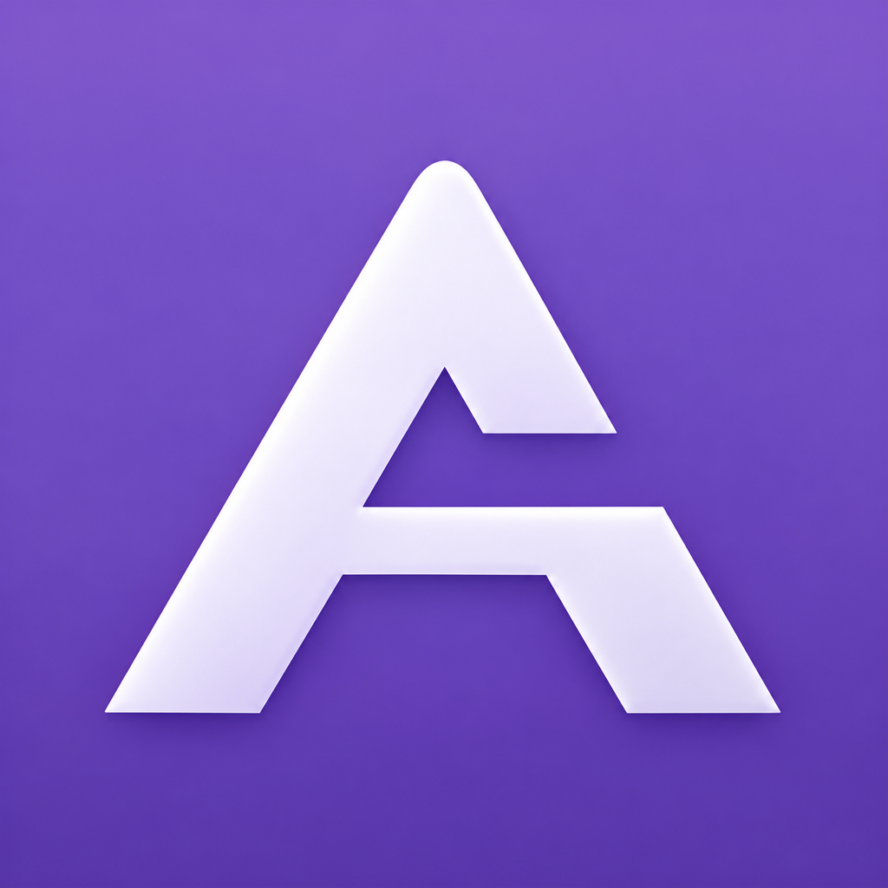

  

<h1 align="center">Arithen</h1>

<strong>Familiar calculations. A private library.</strong>

0.13.2 test build · iOS 17+ · SwiftUI · Source available

  <a href="SETUP.md">Get started</a> &nbsp;·&nbsp;
  <a href="CHANGELOG.md#0132--calculator-taps">What’s new</a> &nbsp;·&nbsp;
  <a href="CHANGELOG.md">Changelog</a> &nbsp;·&nbsp;
  <a href="Docs/CLOUD-BACKUP.md">Cloud choices</a> &nbsp;·&nbsp;
  <a href="Docs/BUILDING.md">Build from source</a>

Arithen is a working calculator with an encrypted library for photos, videos,
Live Photos, and files. It keeps the everyday calculator familiar and gives you
control over which memories leave your phone. Previously **Arithvale / Calc 84**, by **N3mo Studio**.

## Current design

The **Native Settings Kit presentation update** adds larger branded appearance cards, theme tiles, simple rows and focused backup detail pages. Existing settings and data are retained. See the [feature map](Docs/SETTINGS-FEATURE-MAP.md) and [validation limits](Docs/SETTINGS-ADOPTION.md).

The current verified test build is **0.13.2, build 27**. It expands calculator tap targets to cover the full keys. All 183 core, 28 independent recovery and 23 simulator tests passed, including off-center AC taps and rapid repeated digits. [Build and test evidence](https://github.com/N3moStudio/Arithvale-Calc84/actions/runs/45325814299)

New `.arithenbackup` files have redundant authenticated recovery catalogs, individually verified encrypted resources and explicit intact-file recovery. Cloud catalogs use the same authenticated inventory. Existing library data, calculator access, themes and seven-copy folder retention remain. Update the existing installation to retain its library and code. See the [research, format and prior validation limits](Docs/BACKUP-DESIGN-2026-11-22.md).

- **Quicker entry.** Type your code and hold Equals for 0.5 seconds. Entry starts while held and reveals the library after verification, without a modal slide. Ordinary taps calculate; existing code security and throttling stay in place.

- **Bounded automatic backups.** In Backups → Connected Folder, enable Automatic Daily Backup. Save changed libraries at most once per 24 hours while open and unlocked. Keep seven checked automatic copies; manual and pre-existing backups stay protected. Failed verification preserves extra copies. [Policy and limits](Docs/BACKUP-RETENTION.md).

- **Compact calculator.** Familiar button positions, smaller rounded numerals, and the same calculation and unlock behavior.
- **Seven complete themes.** Glacier, Afterhours, Porcelain, Ion, Ember, Bloom, and Blueprint. **Bloom** is the default. Liquid Glass is standard, with accessibility and older-iOS fallbacks; the library follows the theme too.
- **Simple library.** Four portrait columns, a Snaps count, Photos / Videos / Favs filters, and a floating Library / Albums / Search dock. Hold a snap to select; Share, Add to Album, or Delete. Cancel or deselect everything to leave selection.
- **Full-screen viewing.** Photos fill the available viewer, with quick lock and an options menu at the top. Share and Favorite are in that menu; swipe up for details. Photos retain their own colors and aspect ratio.
- **Direct imports.** Photos & Videos starts importing after system selection. Files and backup screens support direct Files selection and received shares. Import enables after a usable selection is prepared; backups also require the source recovery key.
- **Original dates.** Save to Photos preserves saved capture dates after backup recovery, with embedded-metadata fallback for older items. [Photos ordering and backup formats](Docs/BACKUP-AND-PHOTOS.md).
- **Photo Indexing.** On-device text search defaults on and starts after imports finish. Turn it off in Privacy & Access. Its encrypted index stays local; Low Power Mode, heat, inactivity, and other library operations pause work.
- **Your cloud choices remain.** MEGA and Blomp keep separate manual selections and Never Upload lists. Manage those under Cloud Copies.

### Appearance

The same theme styles calculator, library, settings, and app-owned sheets. Liquid Glass is standard; the old surface picker is retired. Reset Appearance returns to Bloom. Native glass requires iOS 26; older versions use material, and accessibility contrast/transparency settings use opaque surfaces. Legacy Titanium preferences map to Bloom.

Text is rounded and one standard Dynamic Type step smaller, with xSmall as the floor. Accessibility categories and touch targets are retained. Legacy tint, layout, video-background, font, and color-mode choices no longer control the UI; stored assets are not deleted. Arithen’s name, icon, bundle identity, library, and keys stay unchanged.

### Import from Files

Open **+ → Import from Files** or **+ → From a Backup** and choose a file directly. Sharing remains an alternative: standalone installations receive the share in Arithen; with LiveContainer, share to LiveContainer and choose Arithen. Unlock the library and tap **Import** once the received copy is ready. Backups require their original recovery key. The host must deliver a downloaded file URL; a cloud collaboration link is not a file.

Received regular files wait encrypted with a separate device-only inbox key. Failed imports keep their received copies for retry. Removing a received copy never removes the original in Files. After Photos import, a compact completion card offers optional deletion of eligible verified originals, with Photos confirmation.

Backups are authenticated before addition, exact duplicates are skipped, and imported resources use the destination library’s existing encryption. Source cloud exclusions are preserved. A new library created during setup gets its own recovery key; importing into an existing library does not rotate its key.

### Settings

**Backups**, **Cloud Copies**, **Storage**, **Privacy & Access**, **Appearance**, and **About**. Photo Indexing and Change Calculator Code are under Privacy & Access; recovery-key help is under Backups. Quick lock remains available in the library and viewer.

[Design and compatibility notes](Docs/UI-REDESIGN.md) · [New-chat handoff](Docs/NEW-CHAT-HANDOFF.md)

Your existing library identity and recovery key stay compatible. The IPA contains
the app, not anyone’s photos, recovery key, or cloud credentials.

[Read the current reliability notes →](Docs/RELIABILITY-2026-11-21.md)

## Get Arithen

The current test IPA is produced by [GitHub Actions](https://github.com/N3moStudio/Arithvale-Calc84/actions/workflows/ipa.yml); older published builds are in [Releases](https://github.com/N3moStudio/Arithvale-Calc84/releases). Sign and install a verified IPA
with your chosen installer, or import it into your existing LiveContainer setup.
The supplied IPA is unsigned; compatibility depends on your iOS version and installer.

For first use, enter **160160** and **hold =**. Save the generated recovery key
separately, then choose your personal calculator code. Ordinary taps on = calculate.

Updating? Save and test an external backup first, then update the same app/data
container. Uninstalling or replacing that container can remove its local library.

[Follow the short setup guide →](SETUP.md)

## Know where your copies are

| Destination | What it contains |
| --- | --- |
| This phone | The encrypted local library in private app storage |
| Files backup | A full encrypted `.arithenbackup` snapshot, including Recently Deleted and a spare recovery catalog |
| MEGA / Blomp | Only that provider’s eligible items and their related resources |
| Photos / Share export | Ordinary, unencrypted copies you explicitly save or share |

**Never Upload stops future uploads of the selected library items.** It does not
erase old cloud backups or automatically recognize separate copies imported later.
Cloud backups are snapshots, not two-way sync. Automatic jobs run while open and
unlocked. Each cloud provider starts in manual mode with nothing selected.

[Cloud setup and limitations](Docs/CLOUD-BACKUP.md) · [Security and storage](SECURITY.md)

## Tested—and what still needs a phone

The release kit records automated Swift tests, independent Python recovery tests,
an iPhone arm64 build, and IPA inspection. The exact results are in
its build report. LiveContainer interactions, Photos permissions, provider Trash,
Keychain behavior, and real MEGA/Blomp round trips require device testing.

This remains a test build. There is no developer-held recovery key or password
reset. Keep an external backup and its original recovery key.

[Phone testing checklist](DEVICE-CHECKS.md) · [Source map](Docs/PROJECT-MAP.md)

## Open to everyone

New original additions are reserved under the [rights notice](LICENSE): no unauthorized copying, redistribution, or sale. GitHub viewing/forking rights, previously MIT-licensed code, and third-party licenses remain in effect. See [the historical MIT notice](Docs/LEGACY-MIT-LICENSE.txt).
Keep the applicable copyright and dependency notices. The software is provided as is.

Built with SwiftUI, CryptoKit, and the official MEGA SDK. Independent of Apple,
MEGA, and Blomp. This repository keeps its original URL and internal compatibility
identifiers so existing libraries and backups continue to work.
