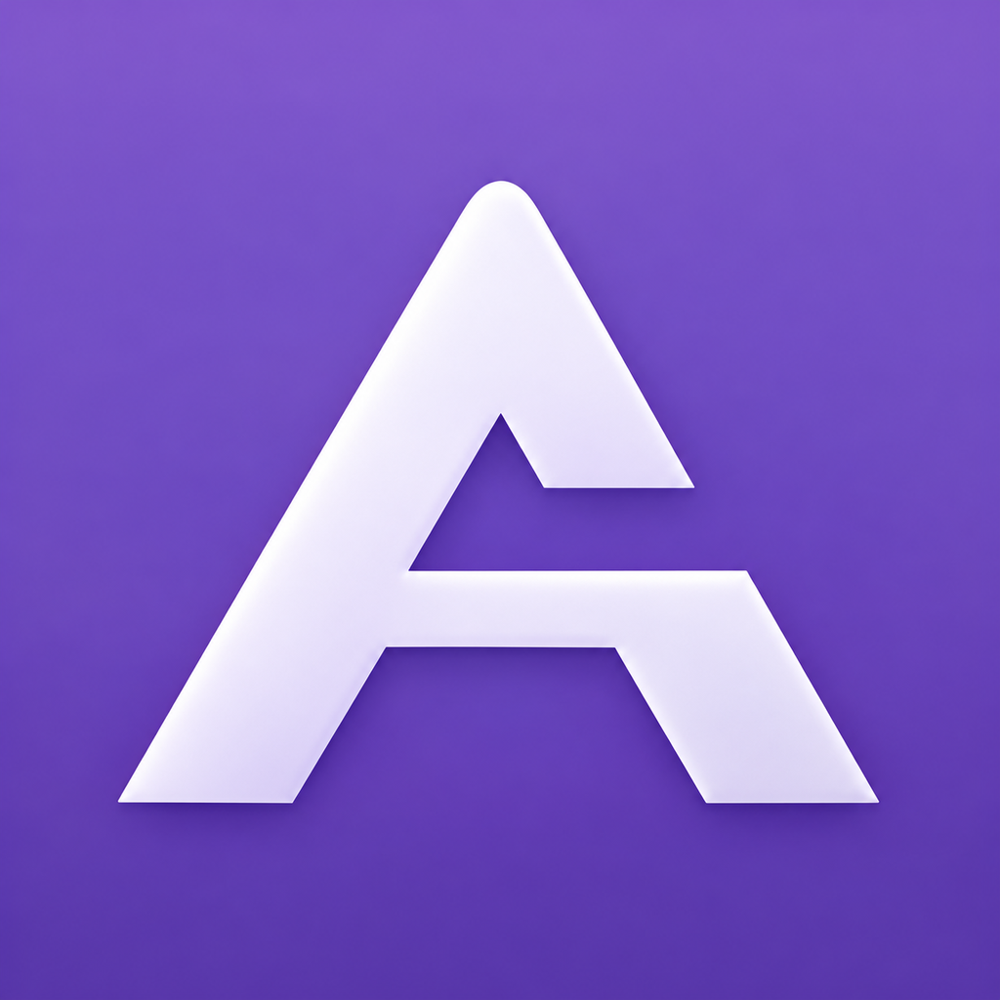

  

<h1 align="center">Arithen</h1>

<strong>Familiar calculations. A private library.</strong>

0.12.3 testing · iOS 17+ · SwiftUI · MIT licensed

  <a href="SETUP.md">Get started</a> &nbsp;·&nbsp;
  <a href="CHANGELOG.md#0123--faster-calculator-entry">What’s new</a> &nbsp;·&nbsp;
  <a href="CHANGELOG.md">Changelog</a> &nbsp;·&nbsp;
  <a href="Docs/CLOUD-BACKUP.md">Cloud choices</a> &nbsp;·&nbsp;
  <a href="Docs/BUILDING.md">Build from source</a>

Arithen is a working calculator with an encrypted library for photos, videos,
Live Photos, and files. It keeps the everyday calculator familiar and gives you
control over which memories leave your phone. Previously **Arithvale / Calc 84**, by **N3mo Studio**.

## Current design

The current test-build target is **0.12.3, build 19**. It shortens hold Equals to half a second and skips the successful opening slide, while retaining daily automatic folder backups with guarded seven-copy retention. It is not a public GitHub release. Update the existing installation to retain its library and calculator code. Native build evidence does not establish physical-device opening latency.

- **Quicker entry.** Type your code and hold Equals for 0.5 seconds. Entry starts while held and reveals the library after verification, without a modal slide. Ordinary taps calculate; existing code security and throttling stay in place.

- **Bounded automatic backups.** In Backups → Connected Folder, enable Automatic Daily Backup. Save changed libraries at most once per 24 hours while open and unlocked. Keep seven checked automatic copies; manual and pre-existing backups stay protected. Failed verification preserves extra copies. [Policy and limits](Docs/BACKUP-RETENTION.md).

- **Compact calculator.** Familiar button positions, smaller rounded numerals, and the same calculation and unlock behavior.
- **Eight complete themes.** Glacier, Afterhours, Porcelain, Ion, Ember, Bloom, Blueprint, and Titanium. **Bloom** is the default. Theme and Surfaces are the only appearance choices; the library follows the theme too.
- **Simple library.** Four portrait columns, a Snaps count, Photos / Videos / Favs filters, and a floating Library / Albums / Search dock. Hold a snap to select; Share, Add to Album, or Delete. Cancel or deselect everything to leave selection.
- **Full-screen viewing.** Photos fill the available viewer, with quick lock and an options menu at the top. Share and Favorite are in that menu; swipe up for details. Photos retain their own colors and aspect ratio.
- **Direct imports.** Photos & Videos starts importing after the system selection. Import from Files and From a Backup receive shares through LiveContainer, then enable Import. No pre-import Review Import screen or backup picker alternatives on the add screen.
- **Photo Indexing.** On-device text search defaults on and starts after imports finish. Turn it off in Privacy & Access. Its encrypted index stays local; Low Power Mode, heat, inactivity, and other library operations pause work.
- **Your cloud choices remain.** MEGA and Blomp keep separate manual selections and Never Upload lists. Manage those under Cloud Copies.

### Appearance

The same theme styles calculator, library, settings, and app-owned sheets. Surfaces offers **Theme default**, **Solid (no glass)**, or **Liquid Glass**. All themes default to Solid. Explicit surface choices survive theme changes. Reset Appearance returns to Bloom and Theme default. Native glass requires iOS 26; older versions use material, and accessibility contrast/transparency settings use opaque surfaces.

Text is rounded and one standard Dynamic Type step smaller, with xSmall as the floor. Accessibility categories and touch targets are retained. Legacy tint, layout, video-background, font, and color-mode choices no longer control the UI; stored assets are not deleted. Arithen’s name, icon, bundle identity, library, and keys stay unchanged.

### Import from Files

In Files, share to LiveContainer, choose Arithen, then unlock the library. Open **+ → Import from Files**, or **+ → From a Backup**, and tap **Import** when the received copy is ready. Backups also require their original recovery key. The host must actually deliver a file URL; a cloud collaboration link is not a file.

Received regular files wait encrypted with a separate device-only inbox key. Failed imports keep their received copies for retry. Removing a received copy never removes the original in Files. After Photos import, a compact completion card offers optional deletion of eligible verified originals, with Photos confirmation.

Backups are authenticated before addition, exact duplicates are skipped, and imported resources use the destination library’s existing encryption. Source cloud exclusions are preserved. A new library created during setup gets its own recovery key; importing into an existing library does not rotate its key.

### Settings

**Backups**, **Cloud Copies**, **Privacy & Access**, **Appearance**, and **About**. Photo Indexing and Change Calculator Code are under Privacy & Access. Storage and recovery-key help remain under Backups. Quick lock remains available in the library and viewer.

[Design and compatibility notes](Docs/UI-REDESIGN.md) · [New-chat handoff](Docs/NEW-CHAT-HANDOFF.md)

Your existing library identity and recovery key stay compatible. The IPA contains
the app, not anyone’s photos, recovery key, or cloud credentials.

[Read the update notes →](Docs/UPDATE-0.9.0.md)

## Get Arithen

Use a verified IPA from this repository’s test
[Releases](https://github.com/N3moStudio/Calc-84/releases). Sign and install it
with your chosen installer, or import it into your existing LiveContainer setup.
The supplied IPA is unsigned; compatibility depends on your iOS version and installer.

For first use, enter **160160** and **hold =**. Save the generated recovery key
separately, then choose your personal calculator code. Ordinary taps on = calculate.

Updating? Save and test an external backup first, then update the same app/data
container. Uninstalling or replacing that container can remove its local library.

[Follow the short setup guide →](SETUP.md)

## Know where your copies are

| Destination | What it contains |
| --- | --- |
| This phone | The encrypted local library in private app storage |
| Files backup | A full encrypted `.c84backup` snapshot, including Recently Deleted |
| MEGA / Blomp | Only that provider’s eligible items and their related resources |
| Photos / Share export | Ordinary, unencrypted copies you explicitly save or share |

**Never Upload stops future uploads of the selected library items.** It does not
erase old cloud backups or automatically recognize separate copies imported later.
Cloud backups are snapshots, not two-way sync. Automatic jobs run while open and
unlocked. Each cloud provider starts in manual mode with nothing selected.

[Cloud setup and limitations](Docs/CLOUD-BACKUP.md) · [Security and storage](SECURITY.md)

## Tested—and what still needs a phone

The release kit records automated Swift tests, independent Python recovery tests,
an iPhone arm64 build, and IPA inspection. The exact results and checksum are in
its build report. LiveContainer interactions, Photos permissions, provider Trash,
Keychain behavior, and real MEGA/Blomp round trips require device testing.

This remains a test build. There is no developer-held recovery key or password
reset. Keep an external backup and its original recovery key.

[Phone testing checklist](DEVICE-CHECKS.md) · [Source map](Docs/PROJECT-MAP.md)

## Open to everyone

Use it, change it, share it, or help make it better under the [MIT license](LICENSE).
Keep the applicable copyright and dependency notices. The software is provided as is.

Built with SwiftUI, CryptoKit, and the official MEGA SDK. Independent of Apple,
MEGA, and Blomp. This repository keeps its original URL and internal compatibility
identifiers so existing libraries and backups continue to work.
