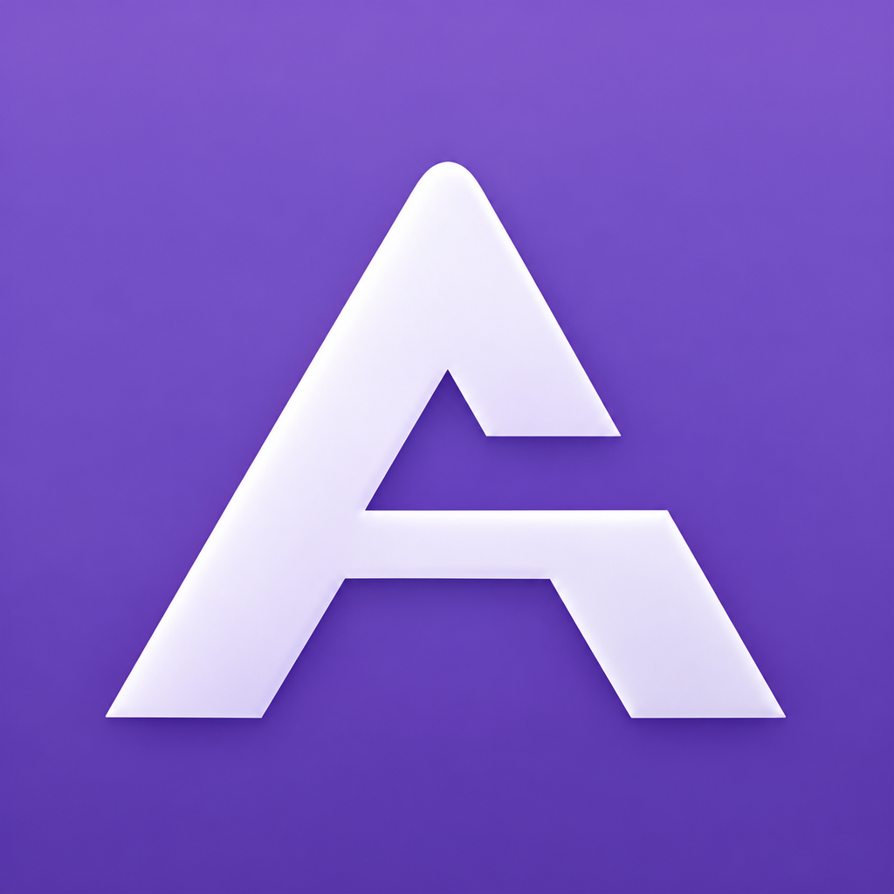

  

<h1 align="center">Arithvale</h1>

<strong>Familiar calculations. A private library.</strong>

0.5.1 testing · iOS 17+ · SwiftUI · MIT licensed

  <a href="SETUP.md">Get started</a> &nbsp;·&nbsp;
  <a href="Docs/UPDATE-0.5.1.md">What’s new</a> &nbsp;·&nbsp;
  <a href="Docs/CLOUD-BACKUP.md">Cloud choices</a> &nbsp;·&nbsp;
  <a href="Docs/BUILDING.md">Build from source</a>

Arithvale is a working calculator with an encrypted library for photos, videos,
Live Photos, and files. It keeps the everyday calculator familiar and gives you
control over which memories leave your phone. Previously **Calc 84**, by **N3mo Studio**.

## Make it yours

- **Calculate naturally.** A familiar keypad, rounded keys, blue accents, clear and backspace controls, and optional scientific functions.
- **Keep your memories.** Browse a photo grid or timeline, search names and albums, mark favorites, and drag across multiple items to select them.
- **Choose your cloud copies.** Select items separately for MEGA and Blomp, or enable automatic backup for a provider. A provider’s Never Upload list takes priority.
- **Import, then decide.** Import Photos, files, or folders. Keep the originals, or explicitly approve moving verified originals to Photos Recently Deleted or the file provider’s Trash.
- **Recover independently.** Save encrypted backups to Files, test recovery, and recover on a computer using the included offline tool.

## The latest

**0.5.1** puts separate backup-file and backup-folder controls directly on the
restore screen, adds visible version/build labels, and introduces horizontal media
paging with details hidden until you swipe up or tap Info. It retains 0.5.0's cloud
selection, exclusions, folder imports, and optional Trash controls.

Your existing library identity and recovery key stay compatible. The IPA contains
the app, not anyone’s photos, recovery key, or cloud credentials.

[Read the update notes →](Docs/UPDATE-0.5.1.md)

## Get Arithvale

Use the IPA attached to the **0.5.1 test prerelease** in this repository’s
[Releases](https://github.com/N3moStudio/Calc-84/releases). Sign and install it
with your chosen installer, or import it into your existing LiveContainer setup.
The supplied IPA is unsigned; compatibility depends on your iOS version and installer.

For first use, enter **160160** and **hold =**. Save the generated recovery key
separately, then choose your personal calculator code. Ordinary taps on = calculate.

Updating? Save and test an external backup first, then update the same app/data
container. Uninstalling or replacing that container can remove its local library.

[Follow the short setup guide →](SETUP.md)

## Know where your copies are

| Destination | What it contains |
| --- | --- |
| This phone | The encrypted local library in private app storage |
| Files backup | A full encrypted `.c84backup` snapshot, including Recently Deleted |
| MEGA / Blomp | Only that provider’s eligible items and their related resources |
| Photos / Share export | Ordinary, unencrypted copies you explicitly save or share |

**Never Upload stops future uploads of the selected library items.** It does not
erase old cloud backups or automatically recognize separate copies imported later.
Cloud backups are snapshots, not two-way sync. Automatic jobs run while open and
unlocked. Each cloud provider starts in manual mode with nothing selected.

[Cloud setup and limitations](Docs/CLOUD-BACKUP.md) · [Security and storage](SECURITY.md)

## Tested—and what still needs a phone

The release kit records automated Swift tests, independent Python recovery tests,
an iPhone arm64 build, and IPA inspection. The exact results and checksum are in
its build report. LiveContainer interactions, Photos permissions, provider Trash,
Keychain behavior, and real MEGA/Blomp round trips require device testing.

This remains a test build. There is no developer-held recovery key or password
reset. Keep an external backup and its original recovery key.

[Phone testing checklist](DEVICE-CHECKS.md) · [Source map](Docs/PROJECT-MAP.md)

## Open to everyone

Use it, change it, share it, or help make it better under the [MIT license](LICENSE).
Keep the applicable copyright and dependency notices. The software is provided as is.

Built with SwiftUI, CryptoKit, and the official MEGA SDK. Independent of Apple,
MEGA, and Blomp. This repository keeps its original URL and internal compatibility
identifiers so existing libraries and backups continue to work.
